# Exploratory Data Analysis: NCR Ride Bookings

Each section was written by one team member. Charts are in `eda_outputs/figures/`.

# Member 1: Data overview and quality

## 1. Size and structure

- Cleaned dataset: 148,767 rows x 30 columns.
- Raw file: 150,000 rows, so the pipeline removed 1,233 rows.
- Completed rides: 92,248 (62.0% of all bookings).

| column | type | blanks | zeros | distinct |
|---|---|---|---|---|
| booking_id | str | 0 | 0 | 148,767 |
| booking_status | str | 0 | 0 | 5 |
| customer_id | str | 0 | 0 | 147,580 |
| vehicle_type | str | 0 | 0 | 7 |
| pickup_location | str | 0 | 0 | 176 |
| drop_location | str | 0 | 0 | 176 |
| avg_vtat_min | float64 | 0 | 10,401 | 182 |
| avg_ctat_min | float64 | 0 | 47,592 | 352 |
| booking_value_inr | float64 | 0 | 47,592 | 2,562 |
| ride_distance_km | float64 | 0 | 47,592 | 4,902 |
| driver_rating | float64 | 0 | 56,519 | 22 |
| customer_rating | float64 | 0 | 56,519 | 22 |
| payment_method | str | 0 | 0 | 6 |
| booking_datetime | str | 0 | 0 | 148,310 |
| booking_date | str | 0 | 0 | 365 |
| year | int64 | 0 | 0 | 1 |
| month | int64 | 0 | 0 | 12 |
| month_name | str | 0 | 0 | 12 |
| day_of_week | str | 0 | 0 | 7 |
| hour | int64 | 0 | 1,365 | 24 |
| is_weekend | bool | 0 | 106,158 | 2 |
| cancelled_by | str | 0 | 0 | 4 |
| reason | str | 0 | 0 | 13 |
| ride_outcome | str | 0 | 0 | 4 |
| is_completed | bool | 0 | 56,519 | 2 |
| fare_per_km | float64 | 0 | 47,592 | 15,529 |
| time_of_day | str | 0 | 0 | 4 |
| distance_category | str | 0 | 0 | 5 |
| fare_category | str | 0 | 0 | 5 |
| is_fare_outlier | bool | 0 | 145,357 | 2 |

## 2. Missing values and zeros

- Blank cells left in the cleaned data: 0.
- Cancelled and failed bookings never had a fare, distance or rating. If the pipeline filled those blanks with 0, the zeros are placeholders, so this EDA treats 0 as 'no value' and uses completed rides for money, distance and ratings.
- Repeated Booking IDs in the cleaned data: 0.

## 3. Distributions

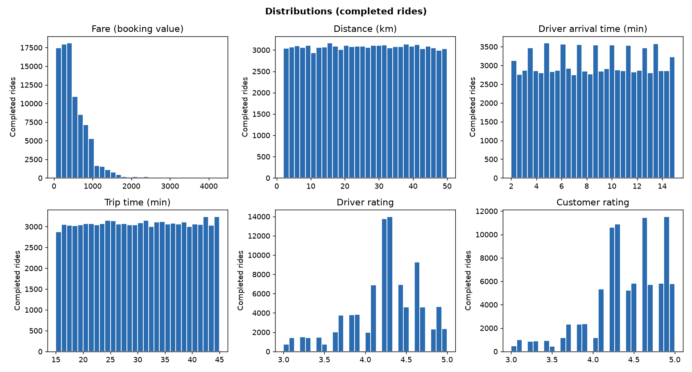

## 4. Outliers

| column | outliers | lower limit | upper limit |
|---|---|---|---|
| Fare | 3,125 | -447.00 | 1,369.00 |
| Distance | 0 | -21.68 | 73.73 |
| Price per km | 9,147 | -30.92 | 75.48 |

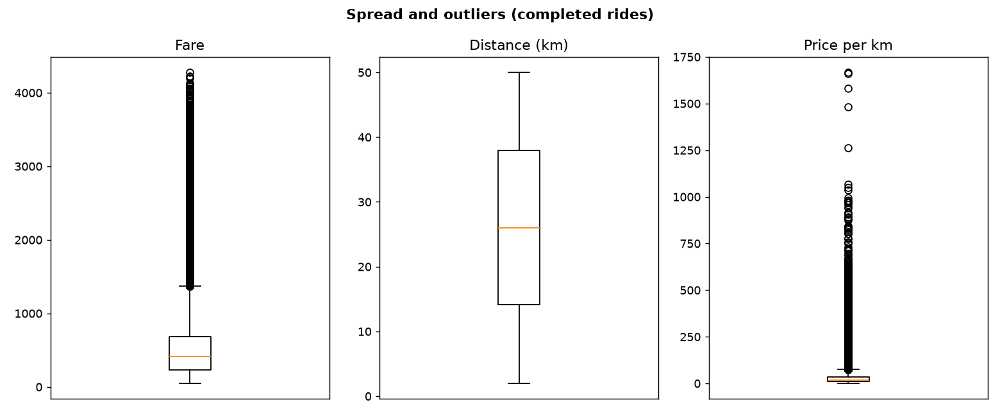

## 5. Correlations

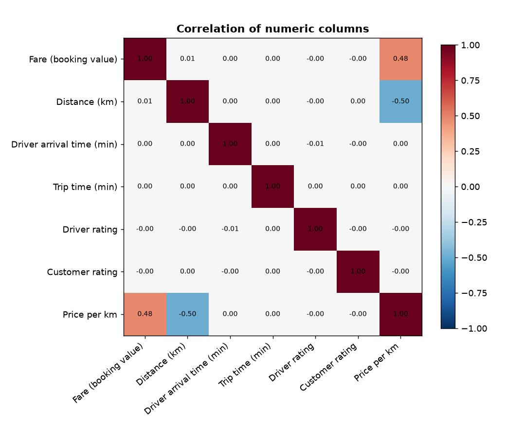

- Correlation between fare and distance: 0.01.

## 6. Summary statistics (completed rides)

| index | count | mean | std | min | 25% | 50% | 75% | max |
|---|---|---|---|---|---|---|---|---|
| x_value | 92,248.00 | 508.19 | 396.26 | 50.00 | 234.00 | 414.00 | 688.00 | 4,277.00 |
| x_distance | 92,248.00 | 26.00 | 13.82 | 2.00 | 14.10 | 26.03 | 37.95 | 50.00 |
| x_vtat | 92,248.00 | 8.51 | 3.75 | 2.00 | 5.30 | 8.50 | 11.80 | 15.00 |
| x_ctat | 92,248.00 | 30.03 | 8.65 | 15.00 | 22.60 | 30.00 | 37.50 | 45.00 |
| x_driver_rating | 92,248.00 | 4.23 | 0.44 | 3.00 | 4.10 | 4.30 | 4.60 | 5.00 |
| x_customer_rating | 92,248.00 | 4.40 | 0.44 | 3.00 | 4.20 | 4.50 | 4.80 | 5.00 |
| x_price_per_km | 92,248.00 | 33.85 | 54.12 | 1.01 | 8.98 | 17.70 | 35.58 | 1,666.99 |

## Member 1: my interpretation

\- The cleaned data is clean enough to analyse. The pipeline removed 1,233 duplicate rows (150,000 to 148,767), renamed columns, fixed IDs and dates, and left no blank cells. However, cancelled and failed bookings have a fare, distance and rating of 0 because those values never existed, so I only used the 92,248 completed rides (62.0% of bookings) for money, distance and rating analysis.

\- Fare has about 3,125 outliers (above roughly 1,369) and price per km has about 9,147 outliers, while distance has none. The high fares are real long or premium rides, so I would keep them but flag them. The very high price per km mostly comes from short rides with a high fare, so analysts should use the median (about 17.7) instead of the mean (about 33.9).

\- Fare and distance are almost unrelated (correlation about 0.01), which is surprising because longer rides normally cost more. The other numeric columns also show very weak links, which suggests the dataset is synthetic and not real ride data.

# Member 2: Time and demand patterns

- Bookings analysed: 148,767 from 2024-01-01 to 2024-12-30.

## 1. Bookings by month

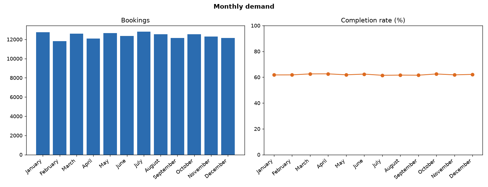

| x_month_name | bookings | completed | cancelled | completion_rate_pct | cancellation_rate_pct |
|---|---|---|---|---|---|
| January | 12,745 | 7,871 | 3,190 | 61.76 | 25.03 |
| February | 11,820 | 7,305 | 3,001 | 61.80 | 25.39 |
| March | 12,611 | 7,890 | 3,115 | 62.56 | 24.70 |
| April | 12,099 | 7,574 | 2,978 | 62.60 | 24.61 |
| May | 12,667 | 7,835 | 3,203 | 61.85 | 25.29 |
| June | 12,347 | 7,704 | 3,059 | 62.40 | 24.78 |
| July | 12,800 | 7,869 | 3,241 | 61.48 | 25.32 |
| August | 12,529 | 7,721 | 3,155 | 61.63 | 25.18 |
| September | 12,153 | 7,480 | 3,042 | 61.55 | 25.03 |
| October | 12,547 | 7,842 | 3,094 | 62.50 | 24.66 |
| November | 12,306 | 7,607 | 3,064 | 61.82 | 24.90 |
| December | 12,143 | 7,550 | 3,049 | 62.18 | 25.11 |

- Busiest month: July (12,800); quietest: February (11,820).

## 2. Bookings by weekday

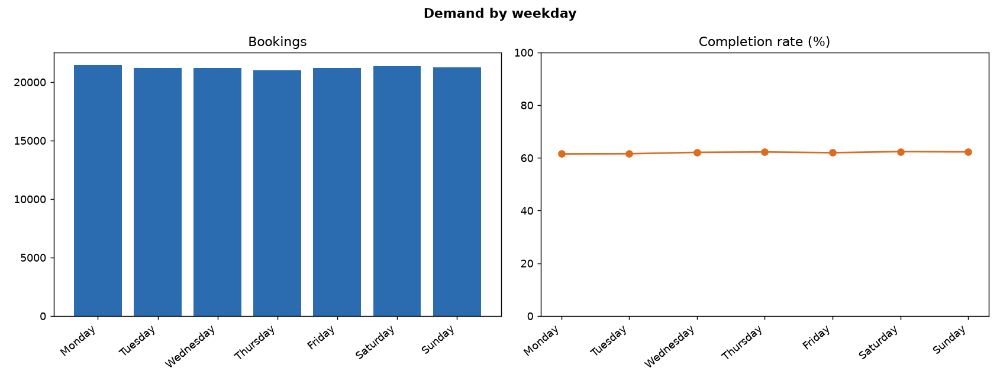

| x_weekday | bookings | completed | cancelled | completion_rate_pct | cancellation_rate_pct |
|---|---|---|---|---|---|
| Monday | 21,460 | 13,202 | 5,511 | 61.52 | 25.68 |
| Tuesday | 21,214 | 13,062 | 5,339 | 61.57 | 25.17 |
| Wednesday | 21,229 | 13,183 | 5,272 | 62.10 | 24.83 |
| Thursday | 21,033 | 13,092 | 5,188 | 62.25 | 24.67 |
| Friday | 21,222 | 13,152 | 5,294 | 61.97 | 24.95 |
| Saturday | 21,363 | 13,328 | 5,286 | 62.39 | 24.74 |
| Sunday | 21,246 | 13,229 | 5,301 | 62.27 | 24.95 |

- Busiest weekday: Monday; quietest: Thursday.

## 3. Bookings by hour

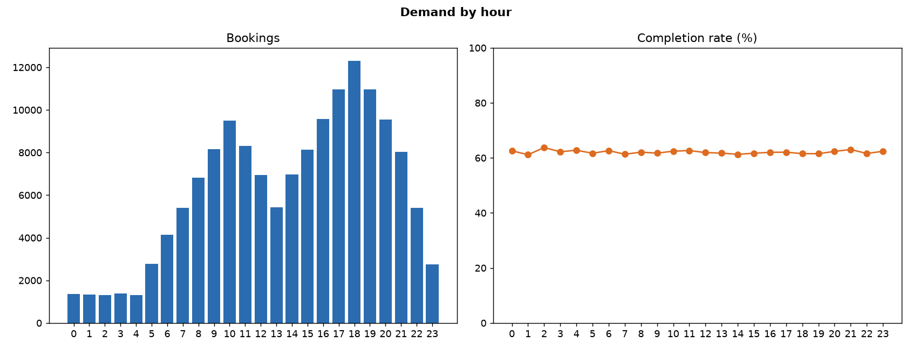

- Peak hour: 18:00 with 12,298 bookings; quietest hour: 4:00.
- Completion rate stays between 61.2% and 63.7% across hours.

## 4. Weekday and hour together

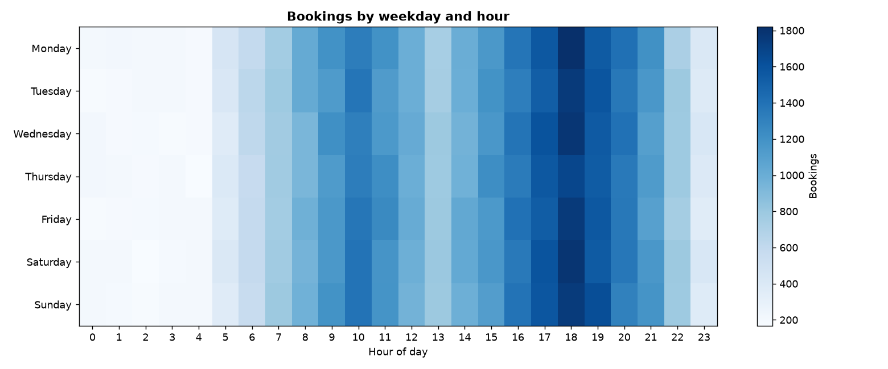

## 5. Time of day and weekends

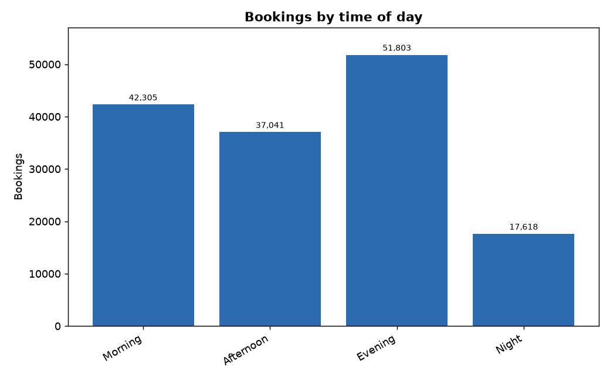

| x_time_of_day | bookings | completed | cancelled | completion_rate_pct | cancellation_rate_pct |
|---|---|---|---|---|---|
| Morning | 42,305 | 26,301 | 10,473 | 62.17 | 24.76 |
| Afternoon | 37,041 | 22,874 | 9,335 | 61.75 | 25.20 |
| Evening | 51,803 | 32,136 | 12,924 | 62.04 | 24.95 |
| Night | 17,618 | 10,937 | 4,459 | 62.08 | 25.31 |

- Average bookings per weekday day: 406.7.
- Average bookings per weekend day: 409.7.
- Gap between the busiest and quietest month: 7.9% of the average month.

## Member 2: my interpretation

- July is the busiest month (12,800 bookings) and February the quietest (11,820). By weekday, Monday is busiest and Thursday quietest, and the peak hour is 18:00 (about 12,300 bookings). Evening is the busiest time of day with 51,803 bookings.

- Demand is almost flat. The gap between the busiest and quietest month is only about 7.9% of an average month, weekday and weekend days both get about 407–410 bookings a day, and the completion rate stays between 61% and 64% in every month and hour. The data shows no strong seasonality.

- The company should make sure enough drivers are available in the evening (around 17:00 to 21:00) when demand is highest. Since completion barely changes by time, the cancellations are probably caused by something other than the time of day.

# Member 3: Vehicles, pricing, payments and ratings

- Completed rides analysed: 92,248. Fares, distances and ratings only exist for completed rides.

## 1. Rides and revenue by vehicle type

| x_vehicle | rides | revenue | avg_fare | avg_distance_km | avg_price_per_km |
|---|---|---|---|---|---|
| Auto | 22,970 | 11,636,666.00 | 506.60 | 25.99 | 34.00 |
| Go Mini | 18,404 | 9,340,882.00 | 507.55 | 25.98 | 33.53 |
| Go Sedan | 16,550 | 8,473,799.00 | 512.01 | 25.98 | 34.65 |
| Bike | 13,921 | 7,081,699.00 | 508.71 | 26.00 | 33.87 |
| Premier Sedan | 11,158 | 5,688,549.00 | 509.82 | 25.97 | 33.72 |
| eBike | 6,480 | 3,262,001.00 | 503.40 | 26.34 | 32.45 |
| Uber XL | 2,765 | 1,395,787.00 | 504.81 | 25.74 | 33.66 |

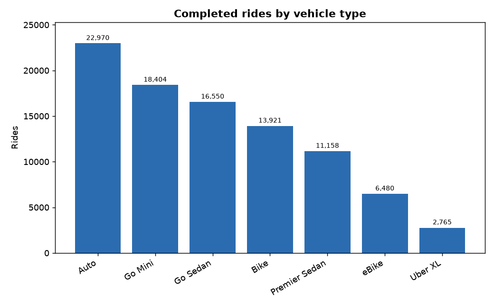

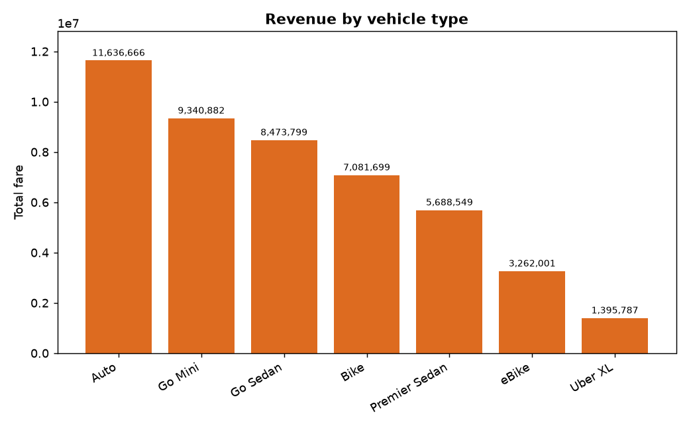

- Auto brings the most rides and revenue (24.8% of all revenue).
- Average fare ranges from 503 to 512 across vehicle types.

## 2. Fare, distance and price per km

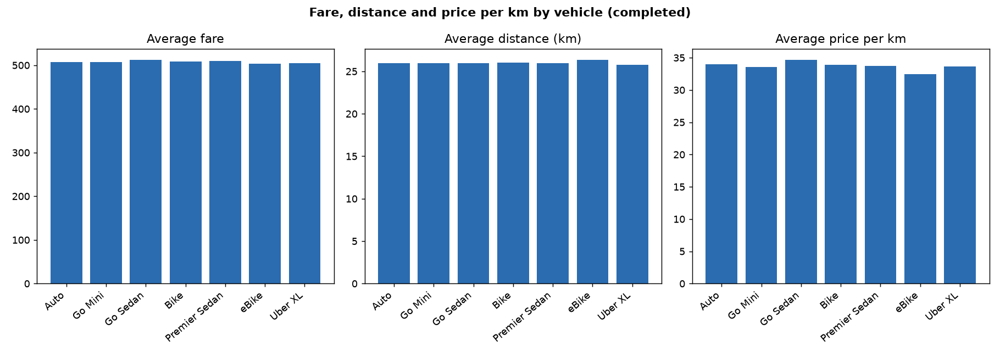

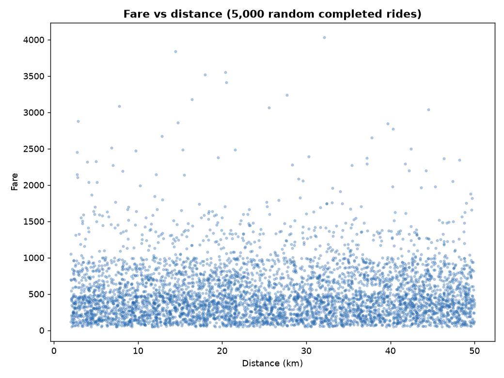

- Correlation between fare and distance: 0.01.
- Median price per km: 17.70; maximum: 1,667.

## 3. Payment methods

| x_payment | rides | avg_fare | total | share_pct |
|---|---|---|---|---|
| UPI | 41,500 | 508.55 | 21,104,861.00 | 44.99 |
| Cash | 22,922 | 508.75 | 11,661,552.00 | 24.85 |
| Uber Wallet | 11,116 | 505.95 | 5,624,188.00 | 12.05 |
| Credit Card | 9,240 | 509.97 | 4,712,151.00 | 10.02 |
| Debit Card | 7,470 | 505.57 | 3,776,631.00 | 8.10 |

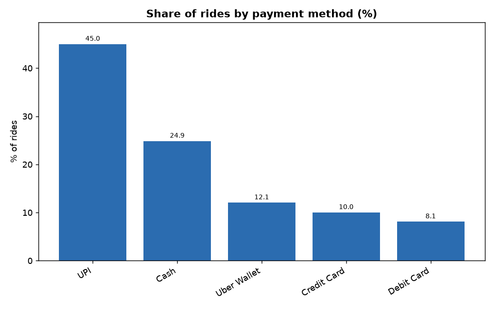

- Most used: UPI (45.0% of rides).

## 4. Ratings

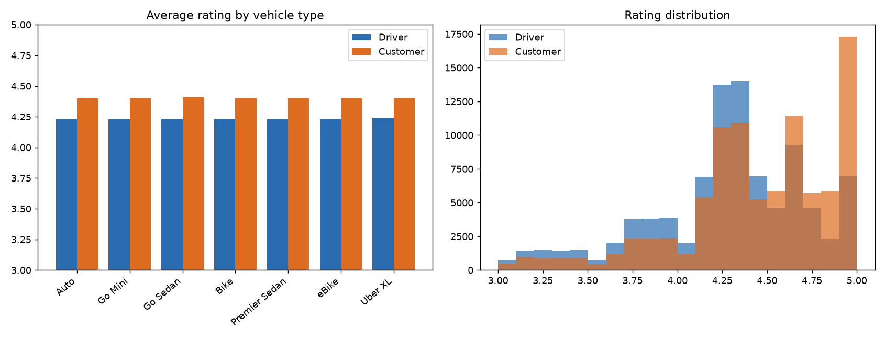

- Average driver rating: 4.23; average customer rating: 4.40.

| x_vehicle | avg_driver_rating | avg_customer_rating |
|---|---|---|
| Auto | 4.23 | 4.40 |
| Go Mini | 4.23 | 4.40 |
| Go Sedan | 4.23 | 4.41 |
| Bike | 4.23 | 4.40 |
| Premier Sedan | 4.23 | 4.40 |
| eBike | 4.23 | 4.40 |
| Uber XL | 4.24 | 4.40 |

## Member 3: my interpretation

\- Auto earns the most revenue (about 11.6 million, 24.8% of the total) and has the most completed rides (22,970), so its lead comes from volume and not from higher fares. Average fares are almost identical across vehicle types, between 503 and 512.

\- Distance does not drive the fare here. The correlation between fare and distance is about 0.01, which is unusual because longer rides normally cost more. Price per km varies a lot (median about 17.7, maximum about 1,667), which shows the fares don't follow distance.

\- UPI is the most used payment method (about 45% of rides), then Cash (about 25%). Average fares are about the same for all payment methods.

\- Ratings barely differ between vehicle types. The average driver rating is about 4.23 and the average customer rating about 4.40, so customers rate drivers slightly lower than drivers rate customers.

# Member 4: Cancellations, service quality and locations

## 1. Booking outcomes

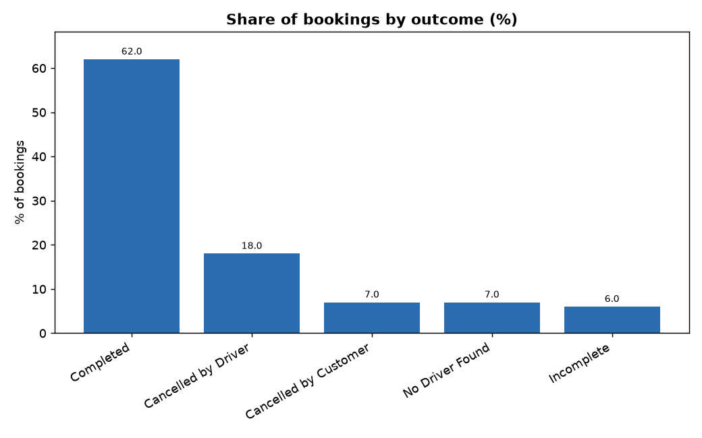

| x_outcome | bookings | share_pct |
|---|---|---|
| Completed | 92,248 | 62.01 |
| Cancelled by Driver | 26,789 | 18.01 |
| Cancelled by Customer | 10,402 | 6.99 |
| No Driver Found | 10,401 | 6.99 |
| Incomplete | 8,927 | 6.00 |

- Only 62.0% of bookings were completed; 38.0% were not.
- Drivers caused 72.0% of all cancellations.

## 2. Why do cancellations happen?

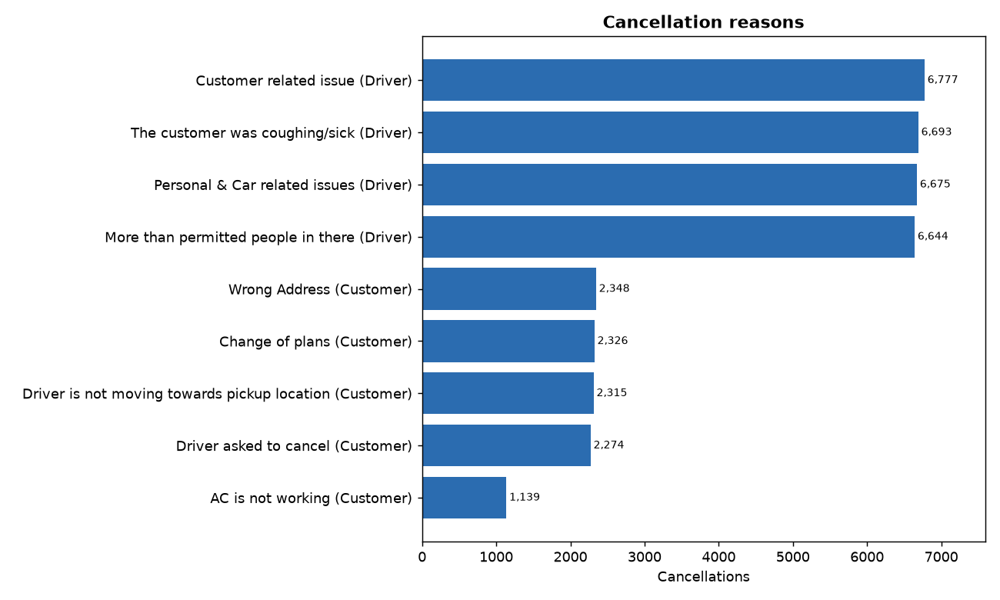

- Most common reason: Customer related issue (Cancelled by Driver), 6,777 cancellations.

## 3. Where and when do bookings fail?

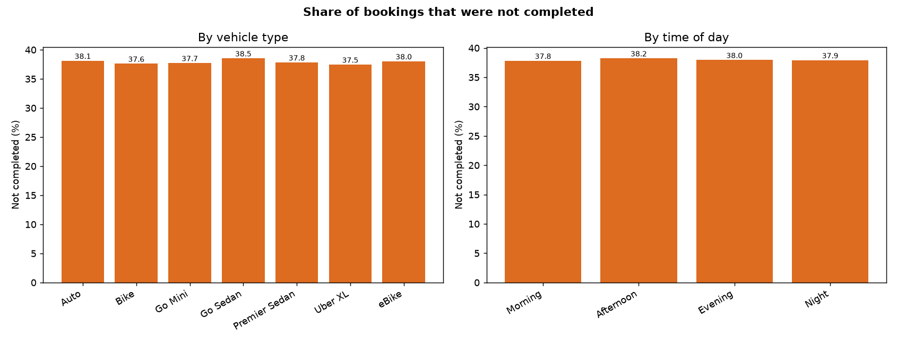

## 4. Driver arrival time (VTAT)

| x_outcome | rides_with_time | avg_arrival_min |
|---|---|---|
| Cancelled by Customer | 10,402 | 12.51 |
| Cancelled by Driver | 26,789 | 7.50 |
| Completed | 92,248 | 8.51 |
| Incomplete | 8,927 | 6.01 |

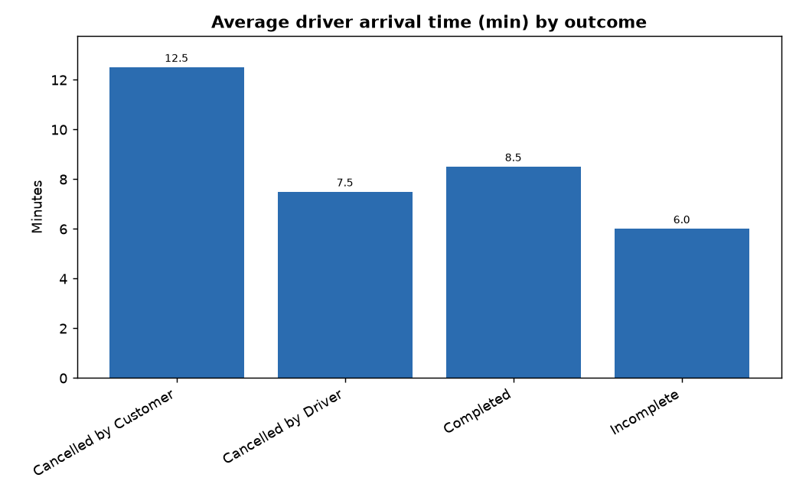

## 5. Locations and routes

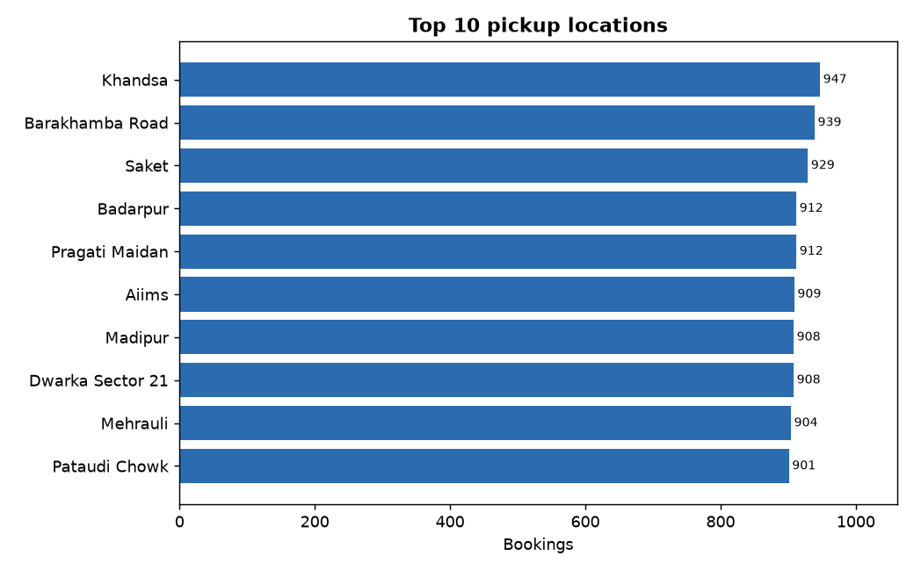

| x_pickup | bookings | completed | cancelled | completion_rate_pct | cancellation_rate_pct |
|---|---|---|---|---|---|
| Khandsa | 947 | 599 | 226 | 63.25 | 23.86 |
| Barakhamba Road | 939 | 591 | 226 | 62.94 | 24.07 |
| Saket | 929 | 555 | 249 | 59.74 | 26.80 |
| Badarpur | 912 | 562 | 230 | 61.62 | 25.22 |
| Pragati Maidan | 912 | 533 | 246 | 58.44 | 26.97 |
| Aiims | 909 | 557 | 233 | 61.28 | 25.63 |
| Madipur | 908 | 571 | 211 | 62.89 | 23.24 |
| Dwarka Sector 21 | 908 | 563 | 224 | 62.00 | 24.67 |
| Mehrauli | 904 | 567 | 222 | 62.72 | 24.56 |
| Pataudi Chowk | 901 | 551 | 214 | 61.15 | 23.75 |

- Ten quietest pickup locations: Ghitorni Village, Chirag Delhi, Ashok Vihar, Laxmi Nagar, Bahadurgarh, Kalkaji, Mandi House, Noida Sector 18, Dilshad Garden, Old Gurgaon.

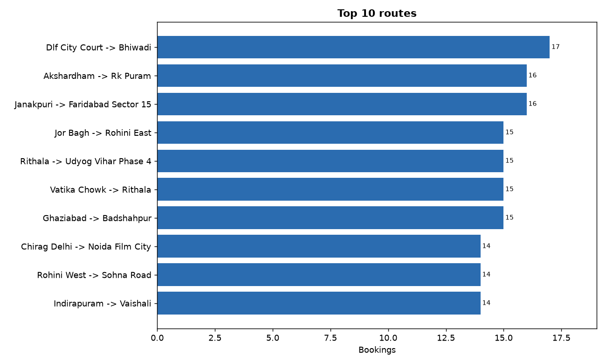

- Most frequent route: Dlf City Court -> Bhiwadi (17 bookings).

## 6. Customers

- 147,580 distinct customers; 1,181 booked more than once (0.80%).

## Member 4: my interpretation

\- Only 62.0% of bookings are completed, so 38.0% fail. Drivers cause most of the problem: they account for about 72% of all cancellations (26,789 cancelled by drivers against 10,402 by customers), and another 6.99% of bookings end with no driver found.

\- The most common cancellation reason is "Customer related issue", given by drivers (6,777 cancellations), and the other driver reasons are almost as common. Customer cancellations are fewer, with "Wrong Address" and "Change of plans" the top reasons. Driver cancellations look partly preventable, for example with better driver incentives or rules.

\- Waiting time differs by outcome. Bookings cancelled by customers had the longest average driver arrival time (about 12.5 minutes), compared with about 8.5 minutes for completed rides. This suggests customers cancel when the driver takes too long to arrive.

\- Pickup locations are very evenly spread, with the busiest, Khandsa, having only 947 bookings. The most frequent route (DLF City Court to Bhiwadi) has only 17 bookings, so no single location or route dominates. Only 0.8% of customers booked more than once.

