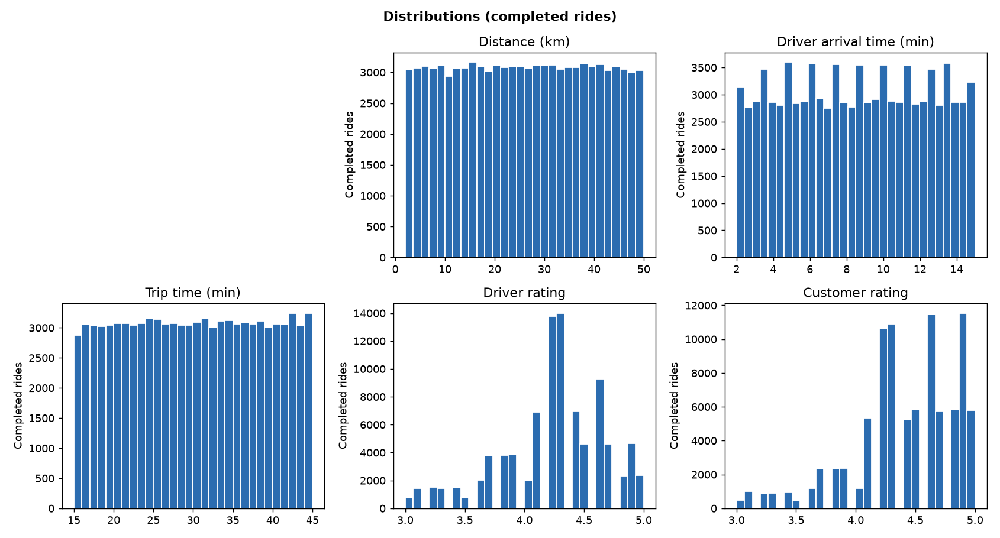
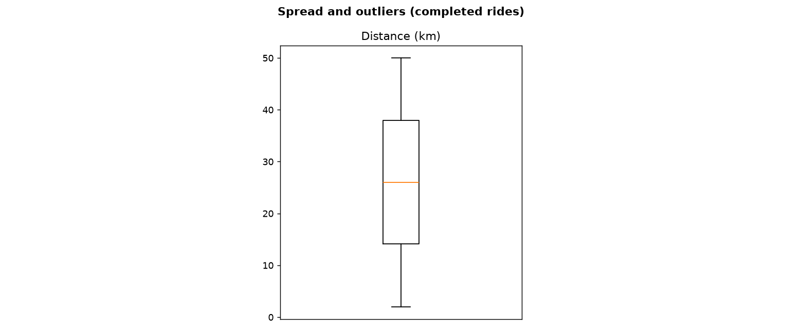
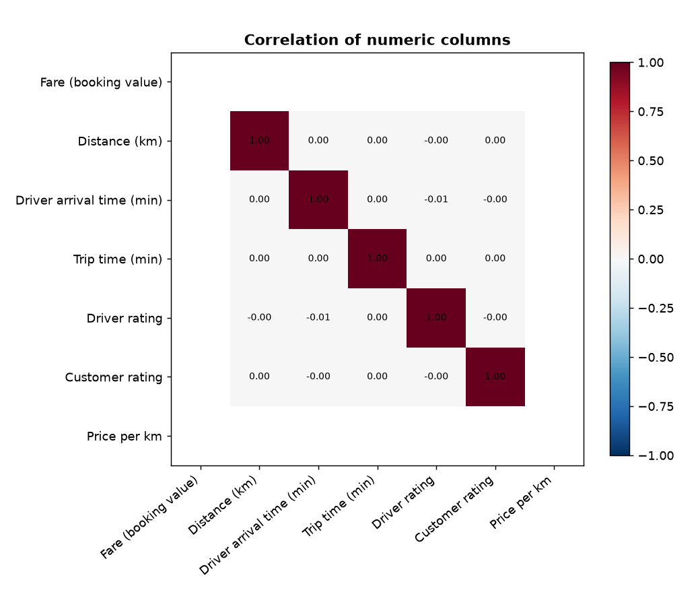

# Member 1: Data overview and quality

## 1. Size and structure

- Cleaned dataset: 148,767 rows x 30 columns.
- Raw file: 150,000 rows, so the pipeline removed 1,233 rows.
- Columns this EDA could not find: value
- Completed rides: 92,248 (62.0% of all bookings).

| column | type | blanks | zeros | distinct |
|---|---|---|---|---|
| booking_id | str | 0 | 0 | 148,767 |
| booking_status | str | 0 | 0 | 5 |
| customer_id | str | 0 | 0 | 147,580 |
| vehicle_type | str | 0 | 0 | 7 |
| pickup_location | str | 0 | 0 | 176 |
| drop_location | str | 0 | 0 | 176 |
| avg_vtat_min | float64 | 0 | 10,401 | 182 |
| avg_ctat_min | float64 | 0 | 47,592 | 352 |
| booking_value_inr | float64 | 0 | 47,592 | 2,562 |
| ride_distance_km | float64 | 0 | 47,592 | 4,902 |
| driver_rating | float64 | 0 | 56,519 | 22 |
| customer_rating | float64 | 0 | 56,519 | 22 |
| payment_method | str | 0 | 0 | 6 |
| booking_datetime | str | 0 | 0 | 148,310 |
| booking_date | str | 0 | 0 | 365 |
| year | int64 | 0 | 0 | 1 |
| month | int64 | 0 | 0 | 12 |
| month_name | str | 0 | 0 | 12 |
| day_of_week | str | 0 | 0 | 7 |
| hour | int64 | 0 | 1,365 | 24 |
| is_weekend | bool | 0 | 106,158 | 2 |
| cancelled_by | str | 0 | 0 | 4 |
| reason | str | 0 | 0 | 13 |
| ride_outcome | str | 0 | 0 | 4 |
| is_completed | bool | 0 | 56,519 | 2 |
| fare_per_km | float64 | 0 | 47,592 | 15,529 |
| time_of_day | str | 0 | 0 | 4 |
| distance_category | str | 0 | 0 | 5 |
| fare_category | str | 0 | 0 | 5 |
| is_fare_outlier | bool | 0 | 145,357 | 2 |

## 2. Missing values and zeros

- Blank cells left in the cleaned data: 0.
- Cancelled and failed bookings never had a fare, distance or rating. If the pipeline filled those blanks with 0, the zeros are placeholders, so this EDA treats 0 as 'no value' and uses completed rides for money, distance and ratings.
- Repeated Booking IDs in the cleaned data: 0.

## 3. Distributions

## 4. Outliers

| column | outliers | lower limit | upper limit |
|---|---|---|---|
| Fare | 0 | nan | nan |
| Distance | 0 | -21.68 | 73.73 |
| Price per km | 0 | nan | nan |

## 5. Correlations

- Correlation between fare and distance: nan.

## 6. Summary statistics (completed rides)

| index | count | mean | std | min | 25% | 50% | 75% | max |
|---|---|---|---|---|---|---|---|---|
| x_value | 0.00 | nan | nan | nan | nan | nan | nan | nan |
| x_distance | 92,248.00 | 26.00 | 13.82 | 2.00 | 14.10 | 26.03 | 37.95 | 50.00 |
| x_vtat | 92,248.00 | 8.51 | 3.75 | 2.00 | 5.30 | 8.50 | 11.80 | 15.00 |
| x_ctat | 92,248.00 | 30.03 | 8.65 | 15.00 | 22.60 | 30.00 | 37.50 | 45.00 |
| x_driver_rating | 92,248.00 | 4.23 | 0.44 | 3.00 | 4.10 | 4.30 | 4.60 | 5.00 |
| x_customer_rating | 92,248.00 | 4.40 | 0.44 | 3.00 | 4.20 | 4.50 | 4.80 | 5.00 |
| x_price_per_km | 0.00 | nan | nan | nan | nan | nan | nan | nan |

