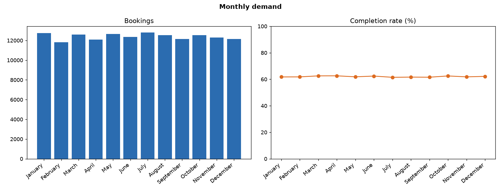
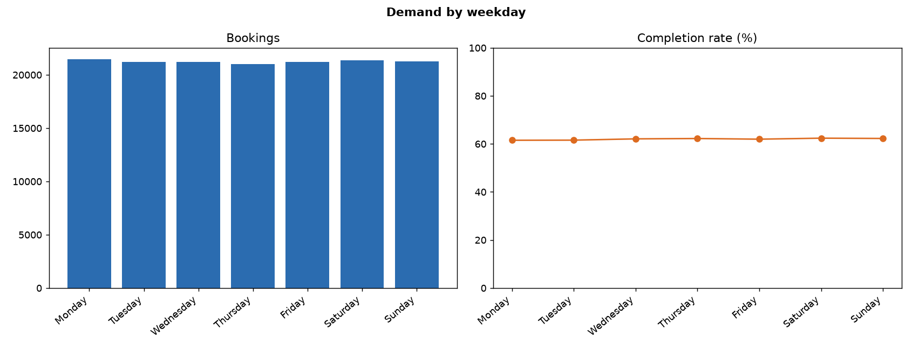
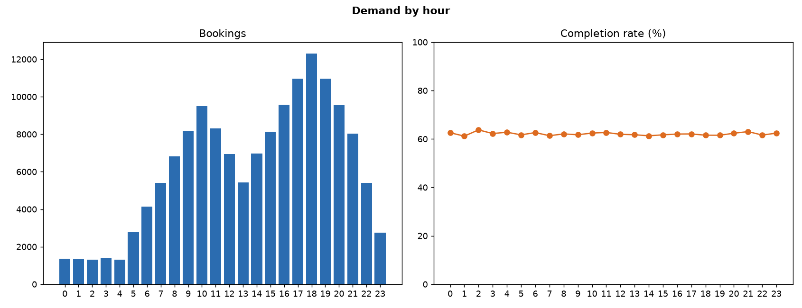
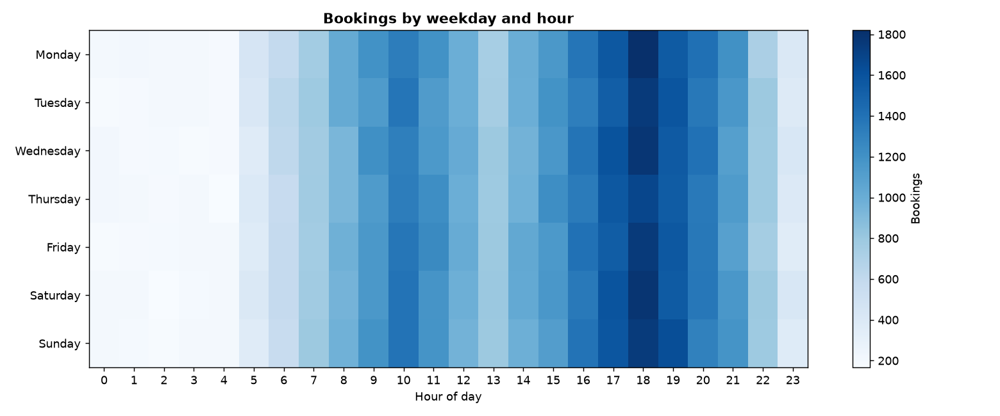
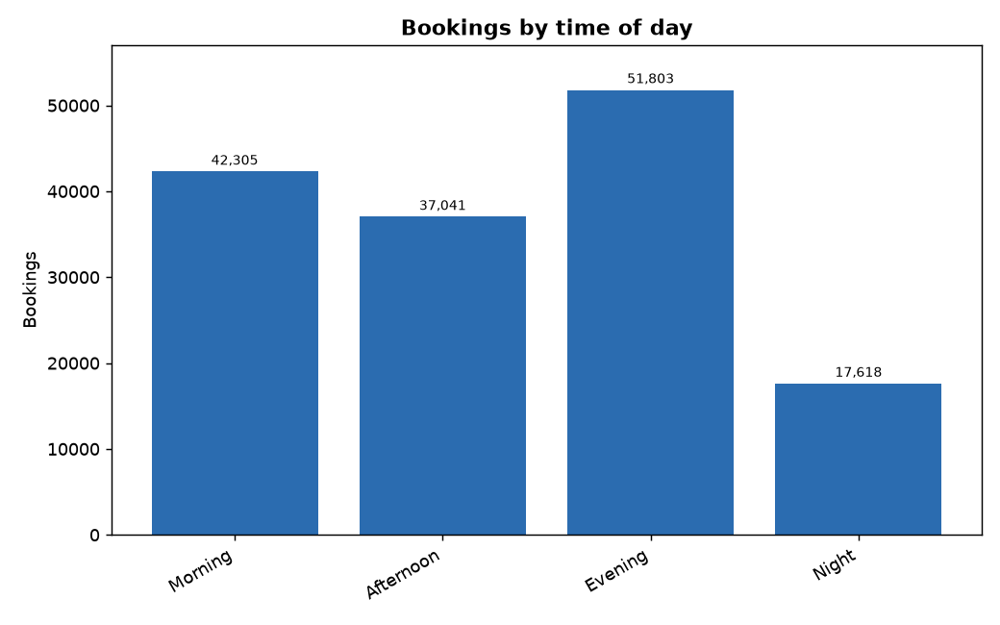

# Member 2: Time and demand patterns

- Bookings analysed: 148,767 from 2024-01-01 to 2024-12-30.

## 1. Bookings by month

| x_month_name | bookings | completed | cancelled | completion_rate_pct | cancellation_rate_pct |
|---|---|---|---|---|---|
| January | 12,745 | 7,871 | 3,190 | 61.76 | 25.03 |
| February | 11,820 | 7,305 | 3,001 | 61.80 | 25.39 |
| March | 12,611 | 7,890 | 3,115 | 62.56 | 24.70 |
| April | 12,099 | 7,574 | 2,978 | 62.60 | 24.61 |
| May | 12,667 | 7,835 | 3,203 | 61.85 | 25.29 |
| June | 12,347 | 7,704 | 3,059 | 62.40 | 24.78 |
| July | 12,800 | 7,869 | 3,241 | 61.48 | 25.32 |
| August | 12,529 | 7,721 | 3,155 | 61.63 | 25.18 |
| September | 12,153 | 7,480 | 3,042 | 61.55 | 25.03 |
| October | 12,547 | 7,842 | 3,094 | 62.50 | 24.66 |
| November | 12,306 | 7,607 | 3,064 | 61.82 | 24.90 |
| December | 12,143 | 7,550 | 3,049 | 62.18 | 25.11 |

- Busiest month: July (12,800); quietest: February (11,820).

## 2. Bookings by weekday

| x_weekday | bookings | completed | cancelled | completion_rate_pct | cancellation_rate_pct |
|---|---|---|---|---|---|
| Monday | 21,460 | 13,202 | 5,511 | 61.52 | 25.68 |
| Tuesday | 21,214 | 13,062 | 5,339 | 61.57 | 25.17 |
| Wednesday | 21,229 | 13,183 | 5,272 | 62.10 | 24.83 |
| Thursday | 21,033 | 13,092 | 5,188 | 62.25 | 24.67 |
| Friday | 21,222 | 13,152 | 5,294 | 61.97 | 24.95 |
| Saturday | 21,363 | 13,328 | 5,286 | 62.39 | 24.74 |
| Sunday | 21,246 | 13,229 | 5,301 | 62.27 | 24.95 |

- Busiest weekday: Monday; quietest: Thursday.

## 3. Bookings by hour

- Peak hour: 18:00 with 12,298 bookings; quietest hour: 4:00.
- Completion rate stays between 61.2% and 63.7% across hours.

## 4. Weekday and hour together

## 5. Time of day and weekends

| x_time_of_day | bookings | completed | cancelled | completion_rate_pct | cancellation_rate_pct |
|---|---|---|---|---|---|
| Morning | 42,305 | 26,301 | 10,473 | 62.17 | 24.76 |
| Afternoon | 37,041 | 22,874 | 9,335 | 61.75 | 25.20 |
| Evening | 51,803 | 32,136 | 12,924 | 62.04 | 24.95 |
| Night | 17,618 | 10,937 | 4,459 | 62.08 | 25.31 |

- Average bookings per weekday day: 406.7.
- Average bookings per weekend day: 409.7.
- Gap between the busiest and quietest month: 7.9% of the average month.
