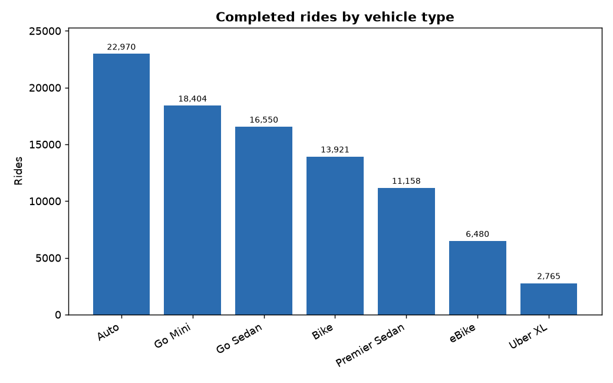
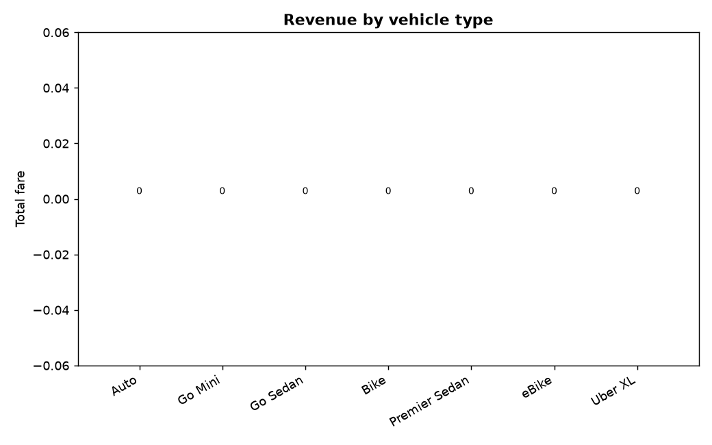
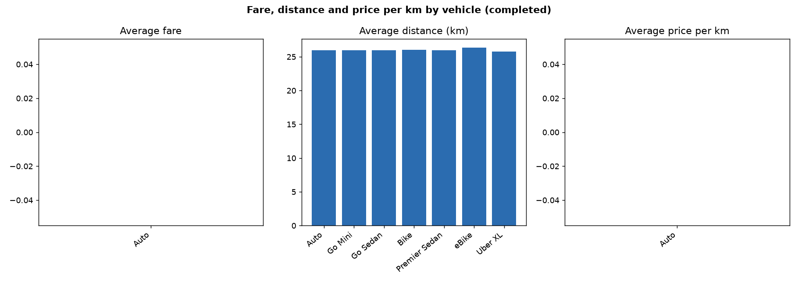
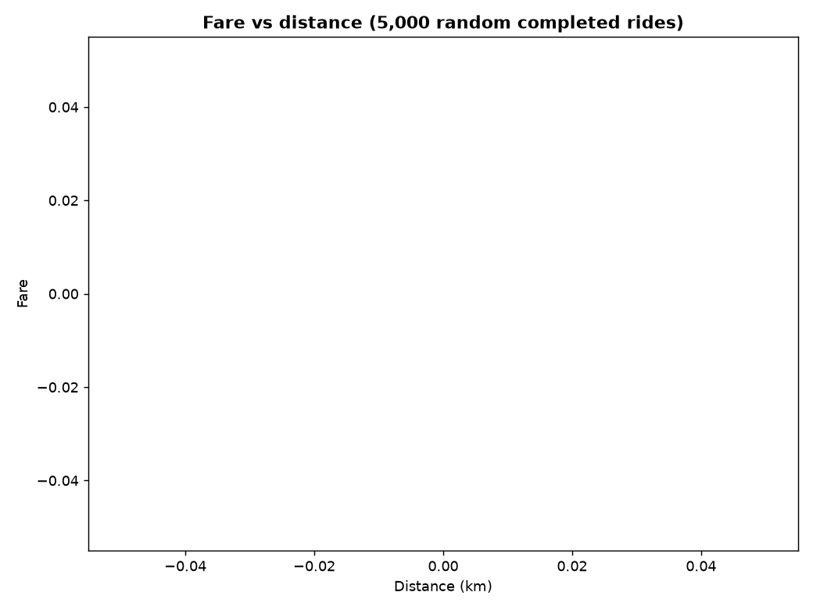
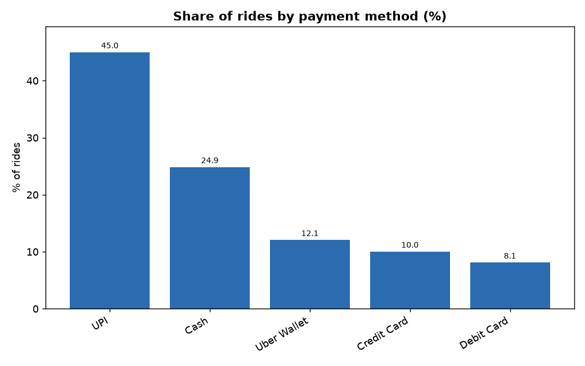
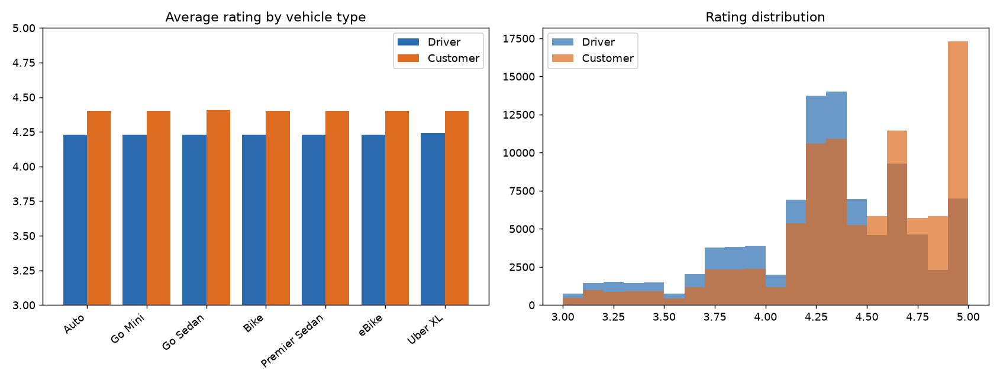

# Member 3: Vehicles, pricing, payments and ratings

- Completed rides analysed: 92,248. Fares, distances and ratings only exist for completed rides.

## 1. Rides and revenue by vehicle type

| x_vehicle | rides | revenue | avg_fare | avg_distance_km | avg_price_per_km |
|---|---|---|---|---|---|
| Auto | 22,970 | 0.00 | nan | 25.99 | nan |
| Go Mini | 18,404 | 0.00 | nan | 25.98 | nan |
| Go Sedan | 16,550 | 0.00 | nan | 25.98 | nan |
| Bike | 13,921 | 0.00 | nan | 26.00 | nan |
| Premier Sedan | 11,158 | 0.00 | nan | 25.97 | nan |
| eBike | 6,480 | 0.00 | nan | 26.34 | nan |
| Uber XL | 2,765 | 0.00 | nan | 25.74 | nan |

- Auto brings the most rides and revenue (nan% of all revenue).
- Average fare ranges from nan to nan across vehicle types.

## 2. Fare, distance and price per km

- Correlation between fare and distance: nan.
- Median price per km: nan; maximum: nan.

## 3. Payment methods

| x_payment | rides | avg_fare | total | share_pct |
|---|---|---|---|---|
| UPI | 41,500 | nan | 0.00 | 44.99 |
| Cash | 22,922 | nan | 0.00 | 24.85 |
| Uber Wallet | 11,116 | nan | 0.00 | 12.05 |
| Credit Card | 9,240 | nan | 0.00 | 10.02 |
| Debit Card | 7,470 | nan | 0.00 | 8.10 |

- Most used: UPI (45.0% of rides).

## 4. Ratings

- Average driver rating: 4.23; average customer rating: 4.40.

| x_vehicle | avg_driver_rating | avg_customer_rating |
|---|---|---|
| Auto | 4.23 | 4.40 |
| Go Mini | 4.23 | 4.40 |
| Go Sedan | 4.23 | 4.41 |
| Bike | 4.23 | 4.40 |
| Premier Sedan | 4.23 | 4.40 |
| eBike | 4.23 | 4.40 |
| Uber XL | 4.24 | 4.40 |

