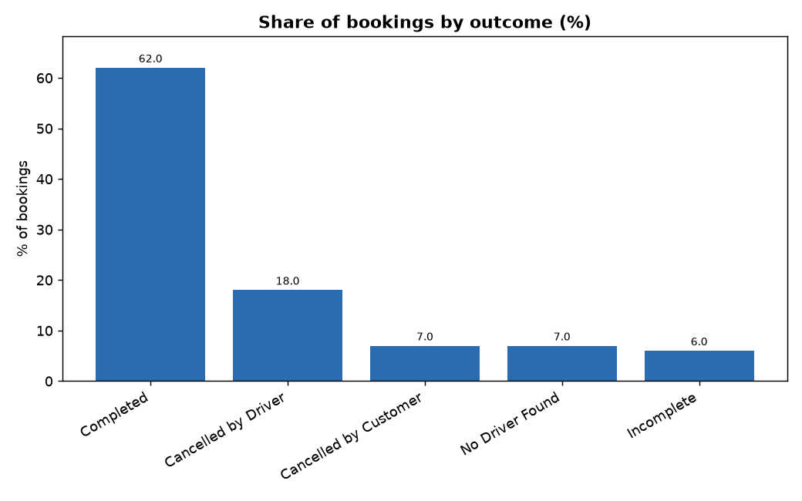
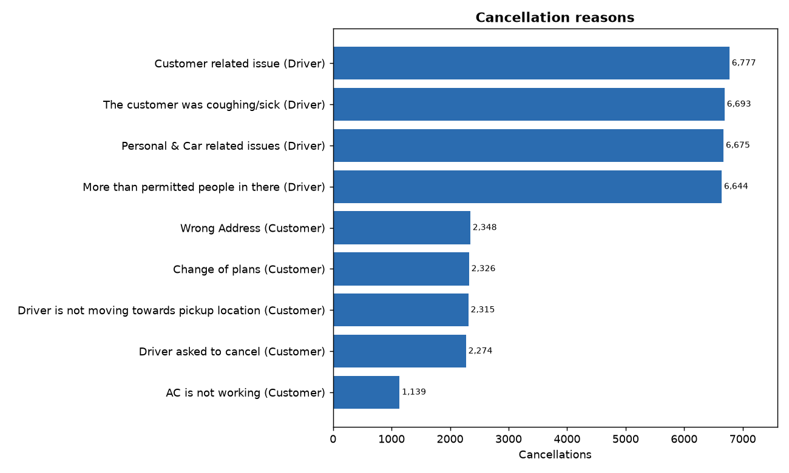
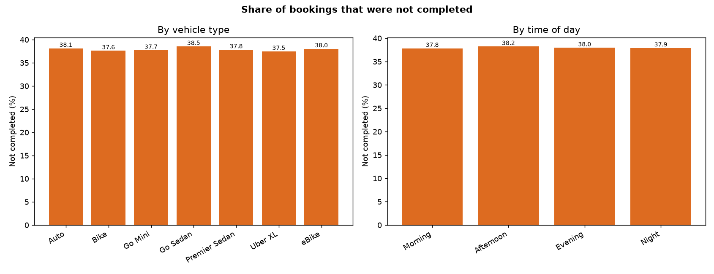
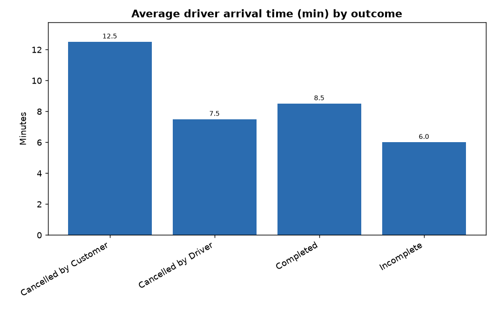
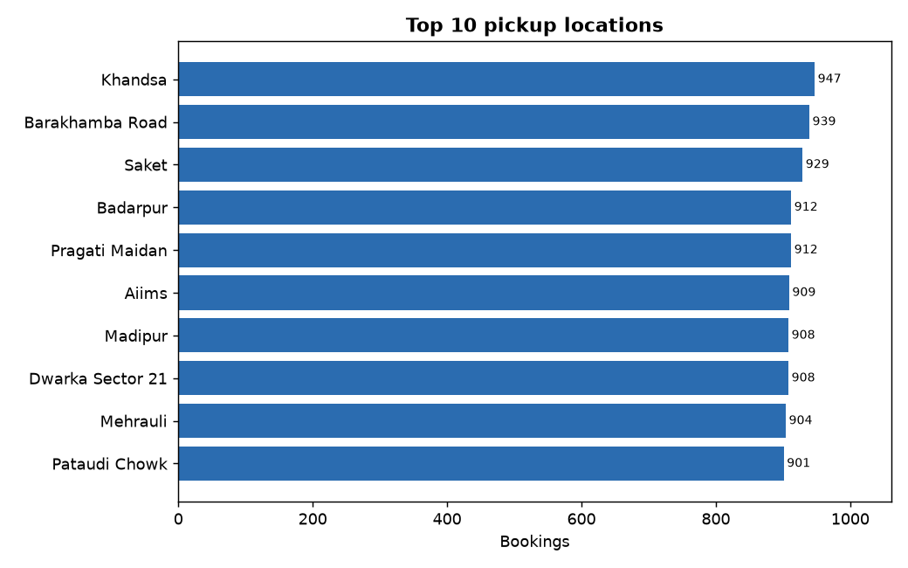
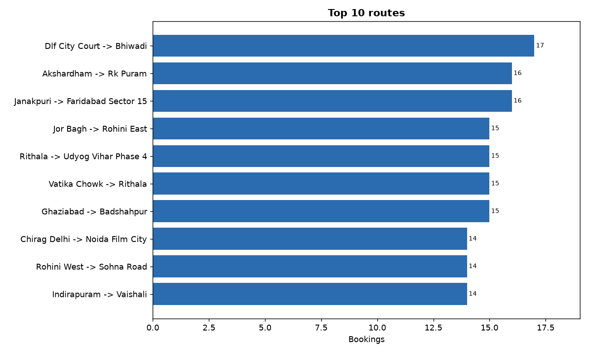

# Member 4: Cancellations, service quality and locations

## 1. Booking outcomes

| x_outcome | bookings | share_pct |
|---|---|---|
| Completed | 92,248 | 62.01 |
| Cancelled by Driver | 26,789 | 18.01 |
| Cancelled by Customer | 10,402 | 6.99 |
| No Driver Found | 10,401 | 6.99 |
| Incomplete | 8,927 | 6.00 |

- Only 62.0% of bookings were completed; 38.0% were not.
- Drivers caused 72.0% of all cancellations.

## 2. Why do cancellations happen?

- Most common reason: Customer related issue (Cancelled by Driver), 6,777 cancellations.

## 3. Where and when do bookings fail?

## 4. Driver arrival time (VTAT)

| x_outcome | rides_with_time | avg_arrival_min |
|---|---|---|
| Cancelled by Customer | 10,402 | 12.51 |
| Cancelled by Driver | 26,789 | 7.50 |
| Completed | 92,248 | 8.51 |
| Incomplete | 8,927 | 6.01 |

## 5. Locations and routes

| x_pickup | bookings | completed | cancelled | completion_rate_pct | cancellation_rate_pct |
|---|---|---|---|---|---|
| Khandsa | 947 | 599 | 226 | 63.25 | 23.86 |
| Barakhamba Road | 939 | 591 | 226 | 62.94 | 24.07 |
| Saket | 929 | 555 | 249 | 59.74 | 26.80 |
| Badarpur | 912 | 562 | 230 | 61.62 | 25.22 |
| Pragati Maidan | 912 | 533 | 246 | 58.44 | 26.97 |
| Aiims | 909 | 557 | 233 | 61.28 | 25.63 |
| Madipur | 908 | 571 | 211 | 62.89 | 23.24 |
| Dwarka Sector 21 | 908 | 563 | 224 | 62.00 | 24.67 |
| Mehrauli | 904 | 567 | 222 | 62.72 | 24.56 |
| Pataudi Chowk | 901 | 551 | 214 | 61.15 | 23.75 |

- Ten quietest pickup locations: Ghitorni Village, Chirag Delhi, Ashok Vihar, Laxmi Nagar, Bahadurgarh, Kalkaji, Mandi House, Noida Sector 18, Dilshad Garden, Old Gurgaon.

- Most frequent route: Dlf City Court -> Bhiwadi (17 bookings).

## 6. Customers

- 147,580 distinct customers; 1,181 booked more than once (0.80%).
