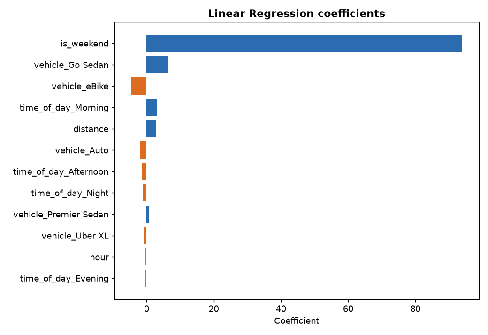
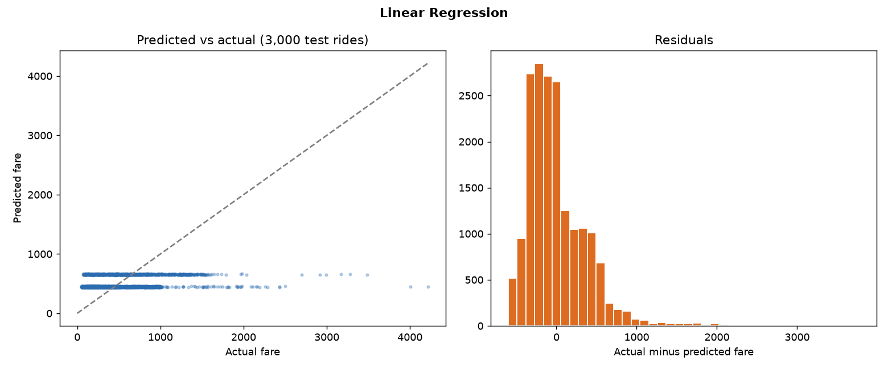
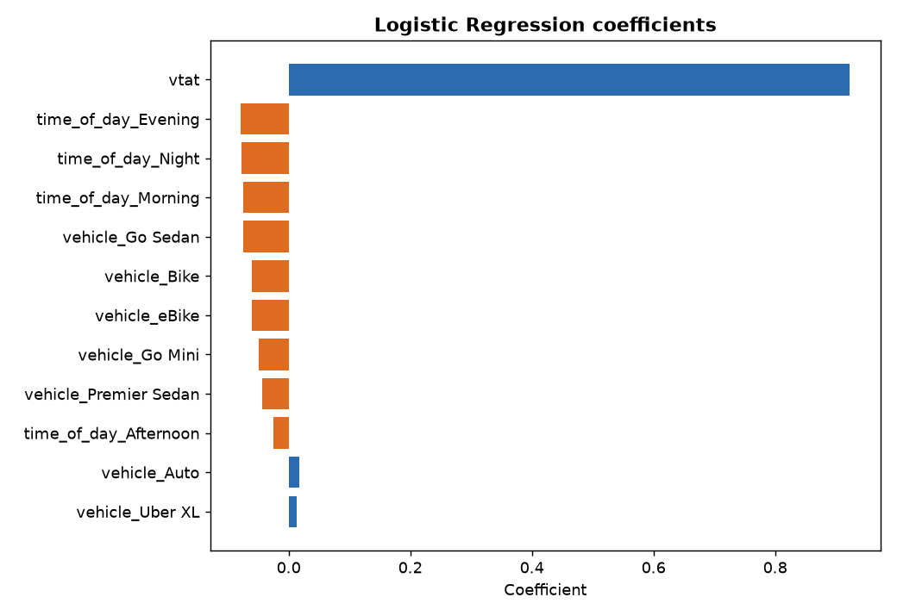
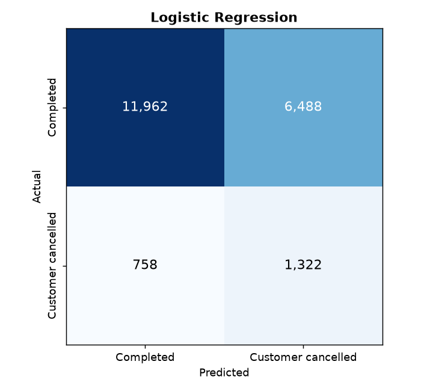
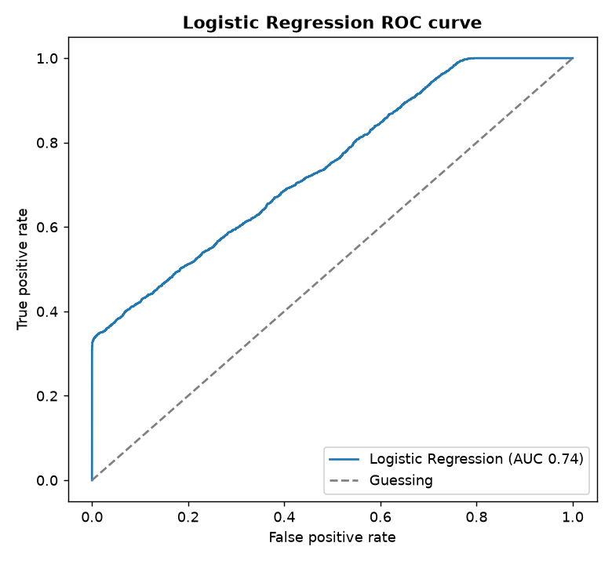

# Member 1: Linear and Logistic Regression

## 1. The two prediction tasks

- Classification: predict the customer cancels the booking (1) or completes (0). 102,650 rows (82,120 train, 20,530 test).
- Inputs: vehicle, time_of_day, vtat, hour, month, is_weekend.
- Regression: predict the fare (booking value) of a completed ride. 92,248 rows (73,798 train, 18,450 test).
- Inputs: vehicle, time_of_day, distance, hour, month, is_weekend.
- Only 10.1% of rides in the classification task are customer cancellations, so accuracy alone is misleading (always guessing 'completed' scores 89.9%). ROC-AUC and F1 are the fairer scores.
- Regression baseline (always predict the average fare): MAE 288, R-squared 0.

## 2. Linear Regression: predicting the fare

- Linear Regression fits one straight-line formula: fare = intercept + a sum of (coefficient x input).
- Test results: MAE 278, RMSE 388, R-squared 0.054.
- The baseline MAE is 288, so the model improves it by 10.
- R-squared 0.054 means the inputs explain a small part of the variation in fare.

- Largest coefficient: is_weekend (+94.0). Numbers are scaled, so coefficients are comparable.

## 3. Logistic Regression: will the customer cancel?

- Logistic Regression turns the same kind of formula into a probability between 0 and 1. class_weight='balanced' makes the rare cancellations count more during training.
- Test results: accuracy 0.647 (baseline 0.899), precision 0.169, recall 0.636, F1 0.267, ROC-AUC 0.742.
- ROC-AUC 0.74 is moderate (0.5 is guessing, 1.0 is perfect).
- Strongest input: vtat (coefficient +0.92; positive means more cancellations).

