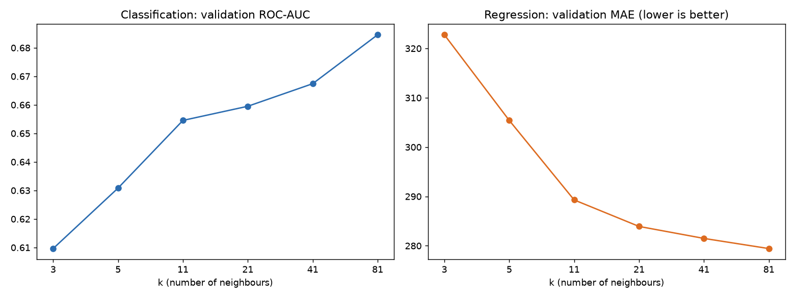
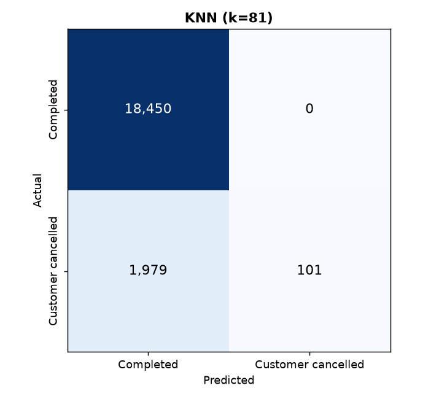
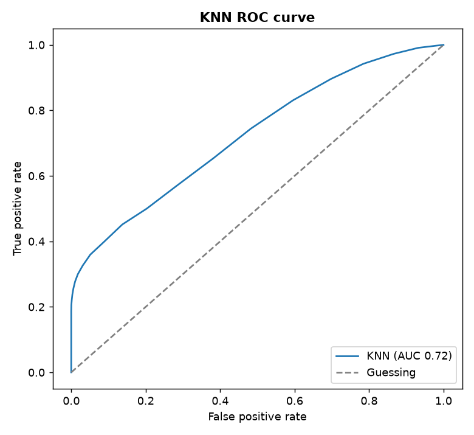
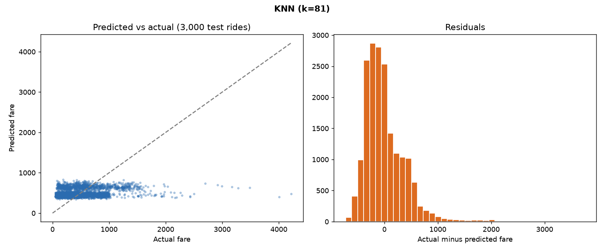

# Member 2: K-Nearest Neighbours

## 1. The two prediction tasks

- Classification: predict the customer cancels the booking (1) or completes (0). 102,650 rows (82,120 train, 20,530 test).
- Inputs: vehicle, time_of_day, vtat, hour, month, is_weekend.
- Regression: predict the fare (booking value) of a completed ride. 92,248 rows (73,798 train, 18,450 test).
- Inputs: vehicle, time_of_day, distance, hour, month, is_weekend.
- Only 10.1% of rides in the classification task are customer cancellations, so accuracy alone is misleading (always guessing 'completed' scores 89.9%). ROC-AUC and F1 are the fairer scores.
- Regression baseline (always predict the average fare): MAE 288, R-squared 0.

## 2. Choosing k

- KNN predicts by looking at the k most similar training rides and voting (classification) or averaging (regression). Too small a k follows noise; too large a k blurs everything.
- KNN is slow on large data, so it trains on a random sample of 15,000 rides and is tested on the full test set.
- Best k on a validation set: 81 for classification, 81 for regression.

## 3. KNN classifier: will the customer cancel?

- Test results: accuracy 0.904 (baseline 0.899), precision 1.000, recall 0.049, F1 0.093, ROC-AUC 0.723.
- ROC-AUC 0.72 is moderate. KNN has no class-weight option, so it rarely predicts the rare 'cancelled' class; look at recall.

## 4. KNN regressor: predicting the fare

- Test results: MAE 280 (baseline 288), RMSE 391, R-squared 0.041.
- The inputs explain almost nothing of the variation in fare.

