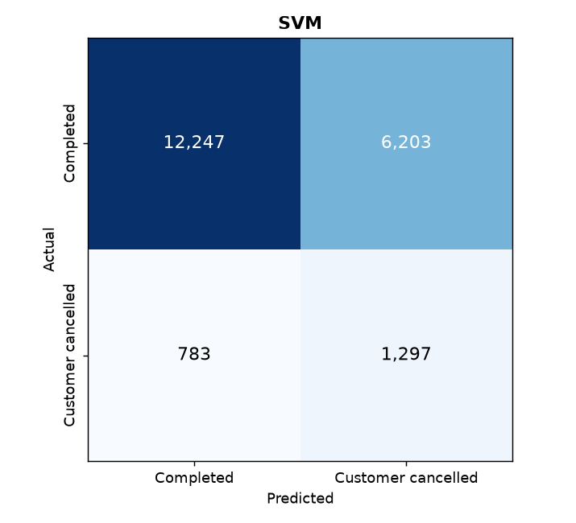
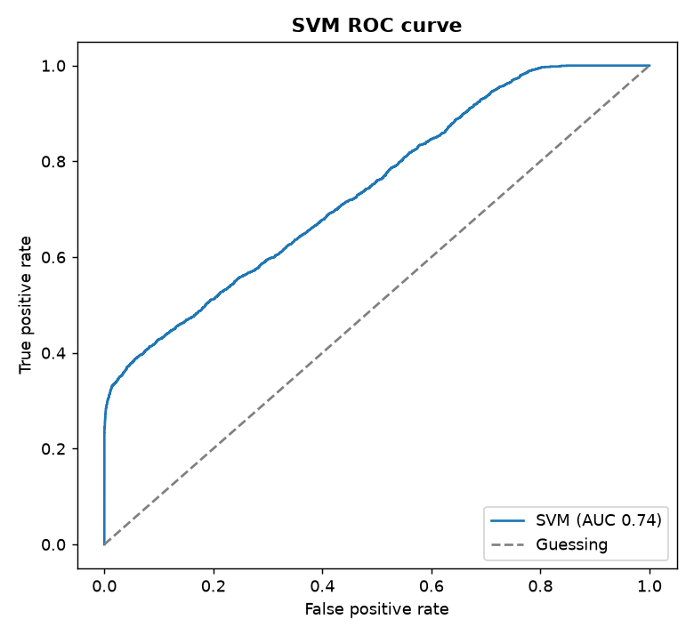
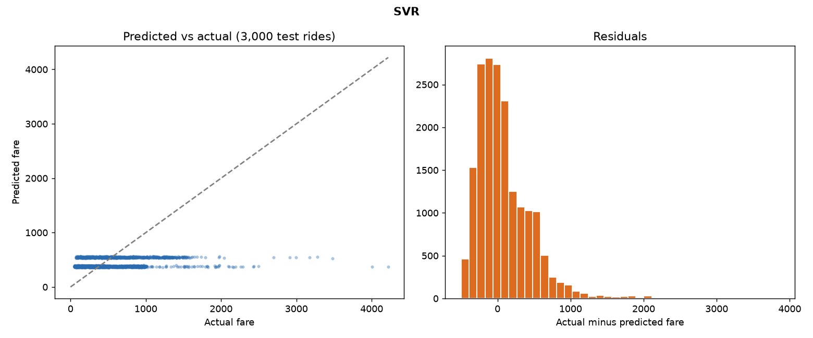

# Member 3: Support Vector Machine

## 1. The two prediction tasks

- Classification: predict the customer cancels the booking (1) or completes (0). 102,650 rows (82,120 train, 20,530 test).
- Inputs: vehicle, time_of_day, vtat, hour, month, is_weekend.
- Regression: predict the fare (booking value) of a completed ride. 92,248 rows (73,798 train, 18,450 test).
- Inputs: vehicle, time_of_day, distance, hour, month, is_weekend.
- Only 10.1% of rides in the classification task are customer cancellations, so accuracy alone is misleading (always guessing 'completed' scores 89.9%). ROC-AUC and F1 are the fairer scores.
- Regression baseline (always predict the average fare): MAE 288, R-squared 0.

## 2. How an SVM works and how it was tuned

- An SVM looks for the boundary (classification) or curve (regression) that separates or follows the data with the widest safe margin. The 'rbf' kernel allows curved boundaries; 'linear' allows only straight ones. C sets how strictly mistakes are punished.
- SVMs are very slow on large data, so the final model trains on 15,000 random rides and the settings were compared on 5,000 rides. Scores are on the full test set. The classification tuning score is ROC-AUC; the regression score is negative MAE.
- Classification tuning (higher is better):

| kernel | C | validation score | seconds |
|---|---|---|---|
| linear | 1.00 | 0.76 | 0.40 |
| rbf | 1.00 | 0.72 | 0.40 |
| rbf | 10.00 | 0.72 | 0.40 |

## 3. SVM classifier: will the customer cancel?

- Chosen settings: kernel=linear, C=1.0.
- Test results: accuracy 0.660 (baseline 0.899), precision 0.173, recall 0.624, F1 0.271, ROC-AUC 0.741.
- ROC-AUC 0.74 is moderate.

## 4. SVR: predicting the fare

- Regression tuning (higher is better, score is negative MAE):

| kernel | C | validation score | seconds |
|---|---|---|---|
| linear | 1.00 | -267.46 | 0.50 |
| rbf | 1.00 | -273.93 | 0.50 |
| rbf | 10.00 | -286.51 | 0.70 |

- Chosen settings: kernel=linear, C=1.0.
- Test results: MAE 270 (baseline 288), RMSE 399, R-squared 0.004.
- The inputs explain almost nothing of the variation in fare.

