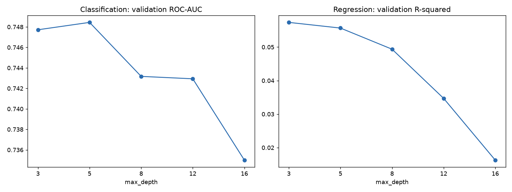
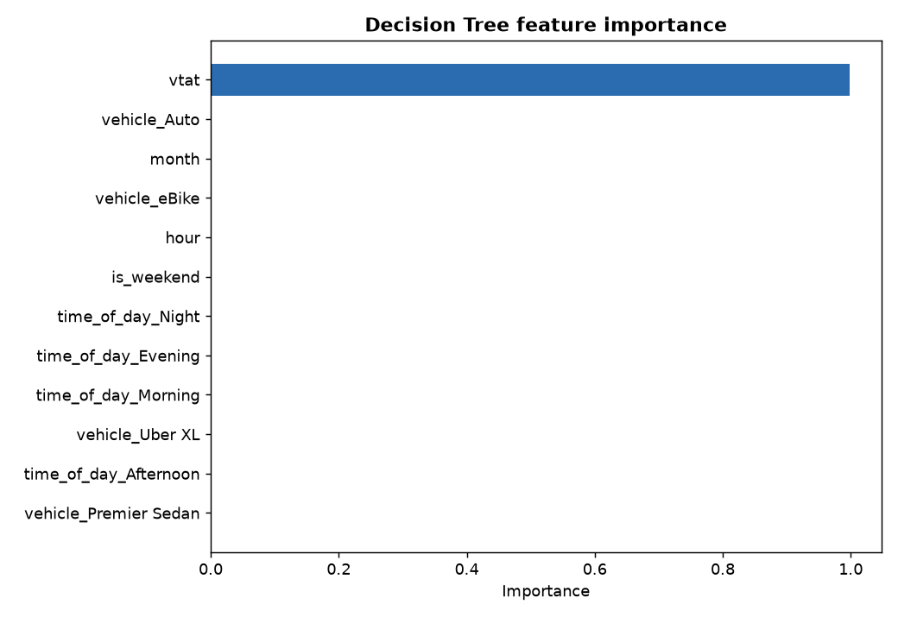
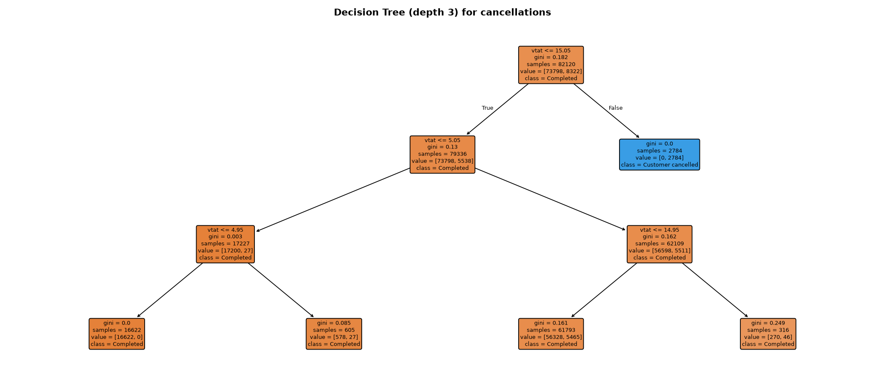
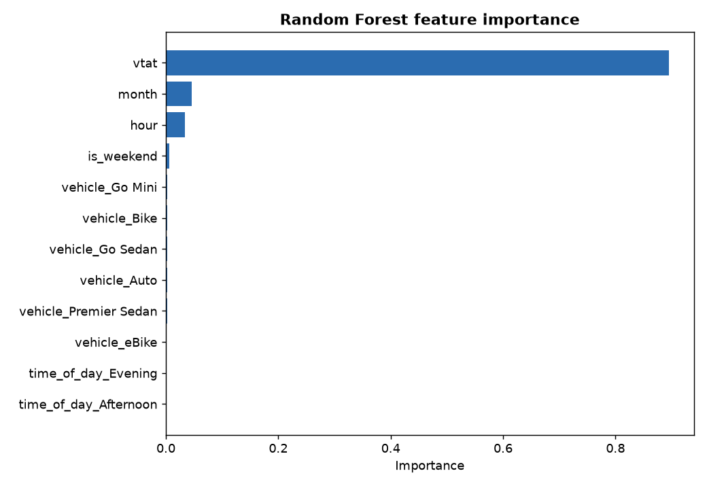
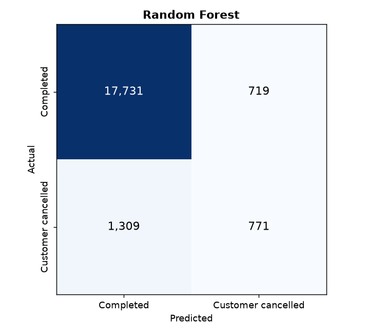
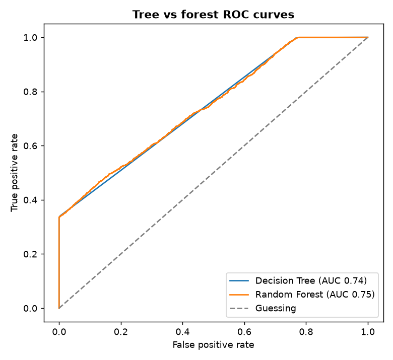
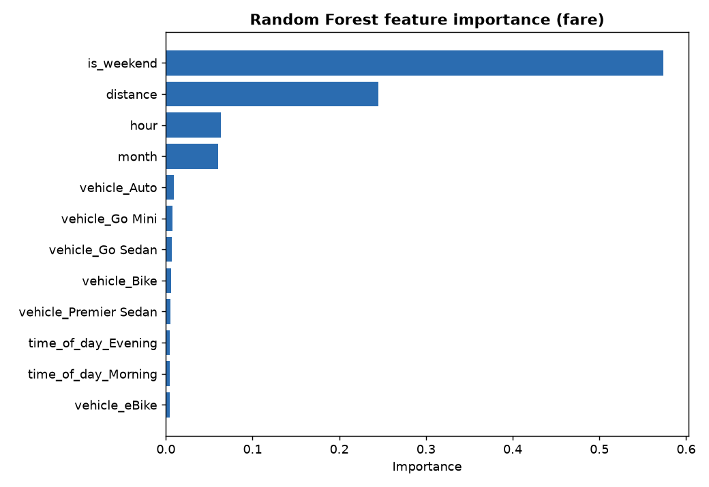
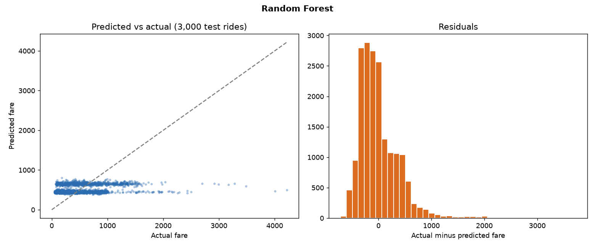

# Member 4: Decision Tree and Random Forest

## 1. The two prediction tasks

- Classification: predict the customer cancels the booking (1) or completes (0). 102,650 rows (82,120 train, 20,530 test).
- Inputs: vehicle, time_of_day, vtat, hour, month, is_weekend.
- Regression: predict the fare (booking value) of a completed ride. 92,248 rows (73,798 train, 18,450 test).
- Inputs: vehicle, time_of_day, distance, hour, month, is_weekend.
- Only 10.1% of rides in the classification task are customer cancellations, so accuracy alone is misleading (always guessing 'completed' scores 89.9%). ROC-AUC and F1 are the fairer scores.
- Regression baseline (always predict the average fare): MAE 288, R-squared 0.

## 2. Decision Tree

- A decision tree asks a series of yes/no questions about the inputs and ends in a prediction. A deeper tree can fit more detail but starts memorising noise.
- Best max_depth on a validation set: 5 for classification, 3 for regression (every leaf holds at least 20 rides).

## 3. Decision Tree: will the customer cancel?

- Decision Tree test results: accuracy 0.930 (baseline 0.899), precision 0.904, recall 0.341, F1 0.496, ROC-AUC 0.744 (moderate).
- Most important input: vtat.

## 4. Decision Tree: predicting the fare

- Decision Tree test results: MAE 278 (baseline 288), RMSE 388, R-squared 0.055 (explains a small part of the variation).

## 5. Random Forest: will the customer cancel?

- A random forest trains many different trees on random parts of the data and averages their answers, which is usually steadier than one tree.
- Random Forest test results: accuracy 0.901 (baseline 0.899), precision 0.517, recall 0.371, F1 0.432, ROC-AUC 0.746 (moderate).
- Most important input: vtat.

## 6. Random Forest: predicting the fare

- Random Forest test results: MAE 279 (baseline 288), RMSE 389, R-squared 0.052 (explains a small part of the variation).
- Most important input: is_weekend.

